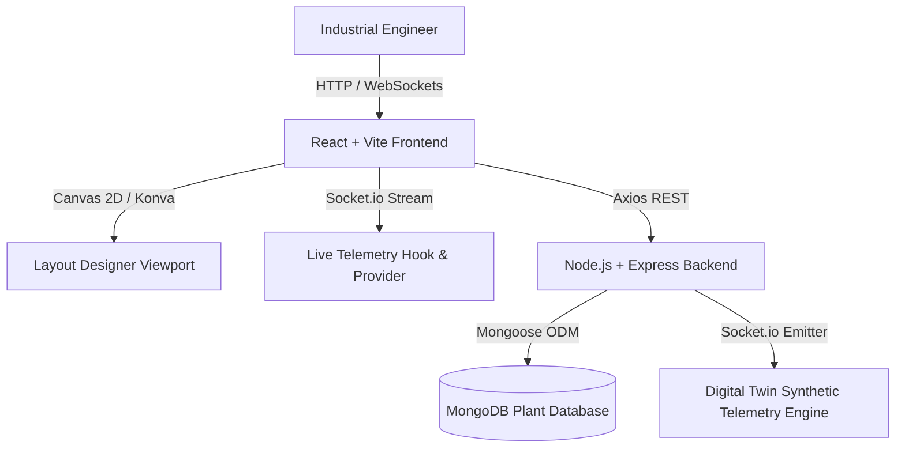

# System Architecture Documentation

## Overview
Factory Layout Planner is a modern Industrial Engineering, Lean Manufacturing, and Digital Twin suite designed to model, simulate, optimize, and monitor factory production floors.

## Architecture Diagram

## Key Subsystems
1. **Layout Designer**: Interactive 2D CAD canvas supporting collision detection, snap-to-grid, port connections, hazard zones, and multi-station routing.
2. **Simulation Engine**: Discrete-event modeling for Work-in-Progress (WIP), cycle times, queue build-ups, and bottleneck identification.
3. **Live MES Command Center**: Real-time Socket.io telemetry streaming vibration, temperature, current, and health scores with synthetic fault injection.
4. **Analytics & Suggestions Engine**: Automatic recommendations for ergonomic clearances, ISO 22400 OEE optimization, and layout restructuring.
